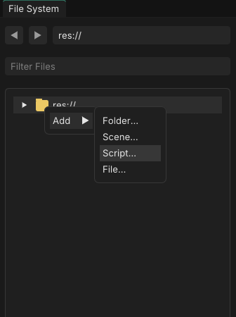
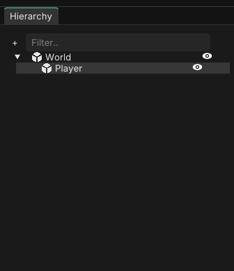
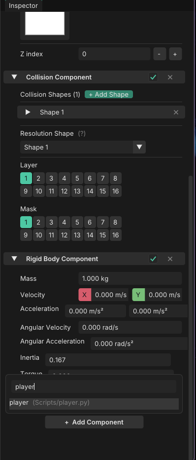
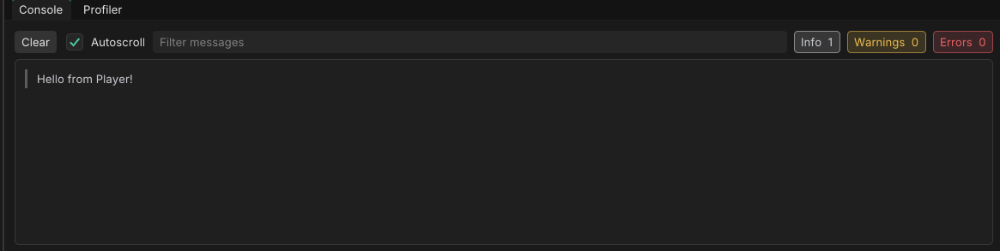
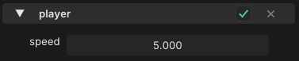

# Scripting Guide

Scripts are how you make things *happen* in your game: moving a player, reacting to a key press, spawning enemies. In this guide you'll write your first script, attach it to an object, and build a simple movement system.

By the end you'll know how to:

- Create a script and attach it to an object
- Run code when the object starts and on every frame
- Print messages to the Console
- Read keyboard input
- Move an object around the scene
- Expose values to the inspector so you can tweak them without touching code

!!! note "Python"
    Scripts are written in Python. If you've never used Python before, you can still follow along. Every example is short and explained.

---

## 1. Creating your first script

<!-- IMAGE: Creating a new script from the FileSystem panel -->


Create a new script file in your project (for example `res://scripts/player.py`) and open it in your editor.

Every script follows the same pattern:

```python
from fusion import *


class Player(Script):
    def OnStart(self):
        Console.Print("Hello from Player!")

    def Process(self, delta):
        pass
```

Let's break that down.

**`from fusion import *`**
This line goes at the top of every script. It makes everything the engine provides (`Script`, `Vector3`, `Input`, `Console`, and more) available in your file.

**`class Player(Script)`**
Every script is a class that inherits from `Script`. The class name is up to you.

**`OnStart(self)`**
Runs **once**, when the object is added to the scene. Use it for setup.

**`Process(self, delta)`**
Runs **every frame**. `delta` is the time in seconds since the previous frame. Use it for anything that changes over time, like movement.

---

## 2. Attaching a script to an object

A script does nothing until it's attached to an object in your scene.

<!-- IMAGE: Selecting an object and the inspector -->


1. Select the object you want to control in the scene.
2. In the inspector, add your script to it.

<!-- IMAGE: Adding the script to the object in the inspector -->


Press **Play**. You should see `Hello from Player!` appear in the Console window.

<!-- IMAGE: Console window showing the message -->


!!! tip
    If nothing shows up, check that the script is attached to an object that's actually in the scene, and that the class name inside the file matches what you expect.

---

## 3. Printing to the Console

The Console is the easiest way to see what your script is doing.

```python
Console.Print("Everything is fine")
Console.PrintWarning("Something looks off")
Console.PrintError("Something broke")
```

Each message is tagged as Info, Warning, or Error in the editor's Console window. You can also use f-strings to print values:

```python
Console.Print(f"Delta time: {delta}")
```

---

## 4. Accessing the object's components

Objects are built from **components**. Each one gives the object a capability:

| Component | What it does |
|---|---|
| `TransformComponent` | Position, rotation and size |
| `RenderComponent` | How the object looks (color, shape, texture) |
| `RigidBodyComponent` | Physics movement (velocity, forces, mass) |
| `CollisionComponent` | Collision shapes and collision events |

From inside a script, use `get_component` to fetch a component from the object the script is attached to:

```python
class Player(Script):
    def OnStart(self):
        self.transform = self.get_component(TransformComponent)
        self.render = self.get_component(RenderComponent)
```

Storing the result on `self` (like `self.transform`) lets you reuse it in `Process` without looking it up every frame.

You can also check whether a component exists, and add one if it doesn't:

```python
if not self.has_component(RigidBodyComponent):
    self.add_component(RigidBodyComponent)
```

And `self.owner` gives you the object the script is attached to:

```python
Console.Print(f"I am attached to {self.owner.name}")
```

---

## 5. Changing things from a script

Once you have a component, you can read and change its properties.

```python
class Player(Script):
    def OnStart(self):
        self.transform = self.get_component(TransformComponent)
        self.render = self.get_component(RenderComponent)

        # Move the object to a position
        self.transform.world_position = Vector3(2, 0, 0)

        # Make it twice as big
        self.transform.size = Vector3(2, 2, 1)

        # Tint it red (red, green, blue, alpha)
        self.render.color = Vector4(1, 0, 0, 1)
```

### Quick note on vectors

Positions, sizes and velocities are stored in vectors. `Vector3(x, y, z)` is the one you'll use most. Vectors support the math you'd expect:

```python
a = Vector3(1, 0, 0)
b = Vector3(0, 1, 0)

c = a + b          # Vector3(1, 1, 0)
d = a * 5.0        # Vector3(5, 0, 0)
```

---

## 6. Reading keyboard input

Use `Input` to check which keys the player is pressing:

```python
def Process(self, delta):
    if Input.is_key_pressed(Key.SPACE):
        Console.Print("Space is being held down")
```

There are three kinds of checks:

| Method | True when |
|---|---|
| `Input.is_key_pressed(key)` | The key is **held down** (every frame) |
| `Input.is_key_just_pressed(key)` | The key was **pressed this frame** |
| `Input.is_key_released(key)` | The key was **released this frame** |

Keys live in the `Key` module: `Key.A`–`Key.Z`, `Key.NUM_0`–`Key.NUM_9`, `Key.SPACE`, `Key.ENTER`, `Key.ESCAPE`, `Key.LEFT_SHIFT`, and the arrows `Key.UP`, `Key.DOWN`, `Key.LEFT`, `Key.RIGHT`.

Mouse buttons work the same way with `Input.is_mouse_button_pressed(Mouse.LEFT)` and friends.

---

## 7. Building a basic movement system

Let's put it all together and make an object move with **WASD**.

```python
from fusion import *


class Player(Script):
    def OnStart(self):
        self.transform = self.get_component(TransformComponent)
        self.speed = 5.0

    def Process(self, delta):
        direction = Vector3(0, 0, 0)

        if Input.is_key_pressed(Key.W):
            direction = direction + Vector3(0, 1, 0)
        if Input.is_key_pressed(Key.S):
            direction = direction + Vector3(0, -1, 0)
        if Input.is_key_pressed(Key.A):
            direction = direction + Vector3(-1, 0, 0)
        if Input.is_key_pressed(Key.D):
            direction = direction + Vector3(1, 0, 0)

        self.transform.world_position = (
            self.transform.world_position + direction * self.speed * delta
        )
```

Press **Play** and move around with WASD.

### How it works

1. Every frame we start with a `direction` of zero.
2. Each held key adds a direction to it. Holding `W` and `D` together gives you up-and-right.
3. We multiply the direction by `speed` to say how fast to move, and by `delta` so that the speed is measured in **units per second**. Without `delta`, your object would move faster on a faster computer.
4. We add the result to the current position.

### Fixing diagonal speed

Moving diagonally is currently faster than moving in a straight line, because the direction `(1, 1, 0)` is longer than `(1, 0, 0)`. Normalizing the direction fixes that:

```python
        if direction != Vector3(0, 0, 0):
            direction = direction.normalized()
```

Put this just before the line that updates `world_position`. `normalized()` returns a new vector with a length of 1, pointing the same way.

!!! note
    `Vector3` and `Vector4` use `normalized()`, while `Vector2` calls the same thing `normalize()`. Both return a new vector rather than changing the original.

---

## 8. Tweaking values from the inspector

Hard-coding `self.speed = 5.0` means you have to edit the script every time you want to try a different speed. Instead, you can **export** the value so it shows up in the inspector:

```python
from fusion import *


class Player(Script):
    speed = export_drag(5.0, 0.0, 20.0)

    def OnStart(self):
        self.transform = self.get_component(TransformComponent)

    def Process(self, delta):
        # ... same movement code as before, using self.speed
        ...
```

<!-- IMAGE: Speed property displayed in the inspector -->


Exports are written as **class-level** assignments (outside of any function). The most common ones:

| Function | Use it for |
|---|---|
| `export(value)` | Any value, with the default widget for its type |
| `export_range(value, min, max)` | A number between a minimum and maximum |
| `export_drag(value, min, max)` | A click-and-drag number field |
| `export_color_edit(value)` | A color |
| `export_file(value, "*.png")` | A file from your project |

You can change the value in the inspector while the game is running to find what feels right, which makes tuning movement much faster.

---

## 9. Going further: physics-based movement

The movement above directly changes the object's position. If your object has a `RigidBodyComponent`, you can move it with physics instead, so it collides with and is pushed by other objects.

```python
from fusion import *


class PhysicsPlayer(Script):
    speed = export_drag(5.0, 0.0, 20.0)
    jump_speed = export_drag(8.0, 0.0, 30.0)

    def OnStart(self):
        self.body = self.get_component(RigidBodyComponent)
        self.collision = self.get_component(CollisionComponent)

        Input.on_key_just_pressed(Key.SPACE, self.jump)

    def Process(self, delta):
        move = 0.0
        if Input.is_key_pressed(Key.A):
            move -= 1.0
        if Input.is_key_pressed(Key.D):
            move += 1.0

        # Set horizontal speed, keep the current vertical speed (gravity, jumps)
        current = self.body.velocity
        self.body.velocity = Vector3(move * self.speed, current.y, 0)

    def jump(self):
        if self.collision.is_grounded():
            current = self.body.velocity
            self.body.velocity = Vector3(current.x, self.jump_speed, 0)
```

Two new ideas here:

- **Callbacks.** `Input.on_key_just_pressed(Key.SPACE, self.jump)` tells the engine to call `self.jump` whenever Space is pressed, so you don't have to check for it every frame.
- **Grounded check.** `is_grounded()` on the `CollisionComponent` tells you whether the object is standing on something, so the player can't jump in mid-air.

---

## Common mistakes

**Forgetting `delta`.** Movement that isn't multiplied by `delta` depends on frame rate.

**Looking up components in `Process`.** Fetch them once in `OnStart` and store them on `self`.

**Forgetting `self.`** Inside a class, use `self.speed`, not `speed`, when you want to read a value stored on the script.

**Nothing happens.** Make sure the script is attached to an object, and check the Console for errors.

---

## Where to next?

You now know the basics: creating scripts, attaching them, reacting to input, and changing components. From here you can explore:

- **The API Reference:** every class and method, listed in full ([API Reference](api/index.md#components))
- **Physics and collisions:** reacting when objects touch, raycasts, constraints
- **Spawning objects and loading scenes**
- **Reinforcement learning:** training agents to play your game ([Getting Started](getting-started.md#enabling-reinforcement-learning))